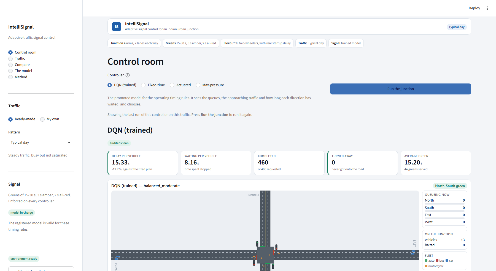

# IntelliSignal

Adaptive traffic signal control for a simulated Indian urban junction. IntelliSignal uses SUMO to compare a trained Deep Q-Network (DQN) with fixed-time, actuated, and max-pressure controllers on the same traffic.

[Run the dashboard](#run-the-dashboard) · [Results](#results) · [Documentation](#documentation)



*Control room screenshot from a single Typical day run.*

## Run the dashboard

From PowerShell on Windows, with Python 3.12 installed:

```powershell
git clone https://github.com/vishwajeet-00010/intelliSignal.git
cd intelliSignal
py -3.12 -m venv .venv
.\.venv\Scripts\python.exe -m pip install -r requirements.txt
.\.venv\Scripts\python.exe -m streamlit run dashboard.py
```

<details>
<summary>Run on macOS or Linux</summary>

```bash
git clone https://github.com/vishwajeet-00010/intelliSignal.git
cd intelliSignal
python3 -m venv .venv
.venv/bin/python -m pip install -r requirements.txt
.venv/bin/python -m streamlit run dashboard.py
```

</details>

The Python requirements include SUMO. The repository also includes the trained model so you can run the dashboard without training one. For a pinned Windows environment, use [the Python 3.12 lock file](requirements-win-py312.lock) in place of `requirements.txt`.

Choose a traffic pattern in the sidebar, then select a controller in **Control room** and click **Run the junction**. Open **Compare** to run several controllers side by side.

## How it works

- **Traffic.** Choose a preset or enter traffic lane by lane. SUMO receives an explicit list of vehicles, including motorcycles, cars, auto-rickshaws, and buses. Each controller in a comparison gets the same vehicle list and simulation seed.
- **Signal control.** Fixed time repeats the green lengths you select. The trained DQN reads the queues and decides whether to end a green or extend it by 3 seconds. The dashboard uses 15–30 seconds of green, followed by 3 seconds of amber and 2 seconds of all-red.
- **Hybrid.** Tune a fixed plan for the selected workload, then test a DQN against it. Hybrid selects the DQN if it lowers delay while completing at least as many trips and leaving no more vehicles waiting to enter.
- **Results and replay.** Inspect delay, waiting time, completed trips, and the signal timeline. **The model** page shows how the checkpoint was selected.

## Results

Six held-out simulated traffic patterns were evaluated with three SUMO seeds per pattern. Lower delay per requested vehicle is better.

| Controller | Mean delay per requested vehicle |
| --- | ---: |
| Trained DQN | **14.97 s** |
| Actuated | 18.33 s |
| Max-pressure | 19.24 s |
| Fixed time selected on validation (30 s north–south, 15 s east–west) | 25.32 s |

The DQN had **40.9% lower delay** than the validation-selected fixed plan and lower delay on all six test patterns. A fixed plan picked afterwards using the test traffic averaged **15.01 s**, close to the DQN. This evaluation covers one simulated junction with generated traffic. Field validation is a next step.

## Documentation

| Topic | Where to look |
| --- | --- |
| Dashboard pages and metrics | [Dashboard guide](docs/dashboard.md) |
| Lane settings and automatic plan selection | [Custom traffic and Hybrid](docs/custom_traffic_and_hybrid.md) |
| Model selection, full results, and reproduction commands | [Evaluation report](output/standard_20261125/FINDINGS.md) |
| Earlier stages, reports, and experiments | [Project archive](docs/history/) |
